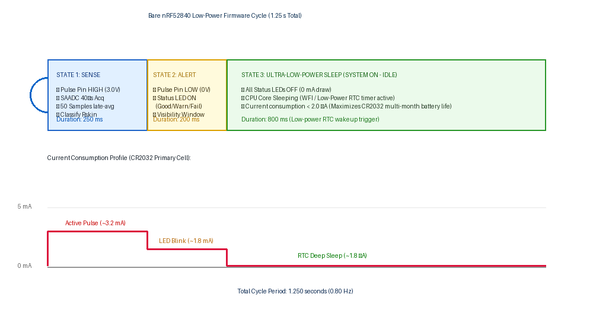

# Arduino Firmware & Bare-Chip State Machine

This directory contains the firmware logic, timing architectures, and pin mapping notes for the bare **Nordic nRF52840-QIAA (aQFN-73)** wearable ESD wristband monitor.

---

## 1. Low-Power Firmware State Machine & Timing

### A. Operational Cycle & Current Profile
To achieve multi-month battery life on a single non-rechargeable CR2032 coin cell, the firmware operates on an asynchronous low-power cycle ($1.25\text{ s}$ total period):

### B. State Breakdown

1. **State 1: SENSE ($250\text{ ms}$)**
   - Drive pulse pin `P0.13` goes HIGH ($3.0\text{ V}$ nominal).
   - The bare nRF52840 SAADC is configured for $40\,\mu\text{s}$ acquisition time ($0.6\text{ V}$ internal reference, $1/6$ gain, $3.6\text{ V}$ full scale).
   - 50 samples are collected during the guarded late window ($t = 237.5\text{--}250\text{ ms}$) after transient settling has completed.
   - The plateau voltage is averaged, and effective skin resistance $R_{\text{skin}}$ is calculated.
2. **State 2: ALERT ($200\text{ ms}$)**
   - Pulse pin `P0.13` returns LOW ($0\text{ V}$).
   - The classified status indicator LED (Green / Yellow / Red) is pulsed ON for $200\text{ ms}$ to provide clear visual feedback to the operator.
3. **State 3: ULTRA-LOW-POWER SLEEP ($800\text{ ms}$)**
   - All GPIOs and status LEDs are turned OFF ($0\text{ mA}$ static LED draw).
   - The ARM Cortex-M4F core enters `System ON - Low Power IDLE` (`__WFE()` / `__WFI()`).
   - High-frequency clock (32 MHz) is powered down; low-power $32.768\text{ kHz}$ RTC timer continues running.
   - Total sleep current: **$< 2.0\,\mu\text{A}$**.

---

## 2. Bare nRF52840-QIAA Physical Pin Mapping

The physical pins on the bare aQFN-73 package map directly to the firmware logic as follows:

| Function | Firmware Identifier | Physical aQFN-73 Pin | Port / Hardware Channel | Electrical Characteristic |
| :--- | :--- | :--- | :--- | :--- |
| **ADC Sense Input** | `ADC_PIN` (`A0`) | **Pin A12** | `P0.02 / AIN0` | High-impedance analog input ($40\,\mu\text{s}$ acq) |
| **Pulse Drive Output** | `PULSE_PIN` | **Pin AD8** | `P0.13` | Digital output ($3.0\text{ V}$ drive during Sense) |
| **Good Status LED** | `GREEN_LED_PIN` | **Pin AC9** | `P0.14` | Active-HIGH push-pull, $1.5\text{ k}\Omega$ series limit |
| **Warning Status LED**| `YELLOW_LED_PIN` | **Pin AD10**| `P0.15` | Active-HIGH push-pull, $1.5\text{ k}\Omega$ series limit |
| **Fail Status LED** | `RED_LED_PIN` | **Pin AC11**| `P0.16` | Active-HIGH push-pull, $1.5\text{ k}\Omega$ series limit |
| **Hardware SWD Clock** | *Hardware SWD* | **Pin AA24**| `SWDCLK` | Dedicated SWD clock line |
| **Hardware SWD I/O** | *Hardware SWD* | **Pin AC24**| `SWDIO` | Dedicated SWD bidirectional data line |
| **Hardware Reset** | *Hardware Reset* | **Pin AC13**| `P0.18 / nRESET` | Active-LOW reset with internal pullup |

---

## 3. Firmware Resistance Calculation & Status Bands

### A. Mathematical Calculation
The resistance is derived in software using the settled plateau voltage $V_{\text{ADC}}$:

$$R_{\text{skin}} = \frac{V_{\text{drive}} \cdot R_{\text{ground}}}{V_{\text{ADC}}} - R_{\text{limit}} - R_{\text{ground}} = \frac{3.0\text{ V} \cdot 1.0\text{ M}\Omega}{V_{\text{ADC}}} - 2.0\text{ M}\Omega$$

### B. Decision Thresholds

| Measured Voltage ($V_{\text{ADC}}$) | Inferred Resistance ($R_{\text{skin}}$) | Classified Status | Indicator Action |
| :--- | :--- | :--- | :--- |
| **$> 0.4286\text{ V}$** | **$< 5.0\text{ M}\Omega$** | **GOOD** | Pulse Green LED (`P0.14`) |
| **$0.0811\text{ V} \le V_{\text{ADC}} \le 0.4286\text{ V}$** | **$5.0\text{ M}\Omega \le R_{\text{skin}} \le 35.0\text{ M}\Omega$** | **WARNING** | Pulse Yellow LED (`P0.15`) |
| **$< 0.0811\text{ V}$** (down to $0.02\text{ V}$) | **$> 35.0\text{ M}\Omega$** | **FAIL** | Pulse Red LED (`P0.16`) |
| **$\le 0.0200\text{ V}$** | Open circuit / disconnected | **FAIL (OPEN)** | Pulse Red LED (`P0.16`) |
| **$> 1.5000\text{ V}$** | Hardware short / fault | **FAIL (FAULT)** | Pulse Red LED (`P0.16`) |

---

## 4. Source Files

- [`ESD_Wristband_Firmware.ino`](file:///C:/Fall%2026%20ESD%20Project/Arduino%20Code/ESD_Wristband_Firmware.ino): Arduino prototype sketch demonstrating the ADC averaging and classification functions.
- [`firmware_timing_state_machine.png`](file:///C:/Fall%2026%20ESD%20Project/Arduino%20Code/firmware_timing_state_machine.png): State machine and current profile graphic.
