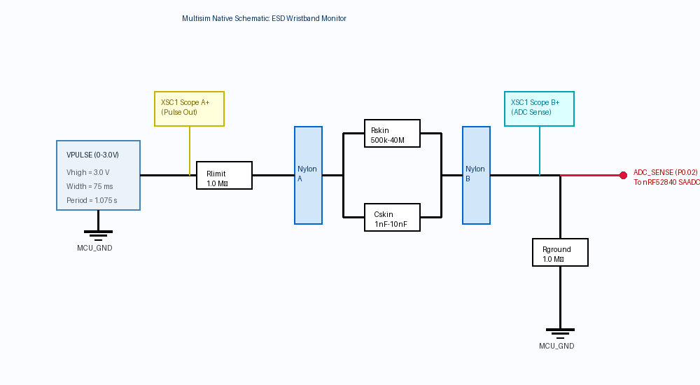
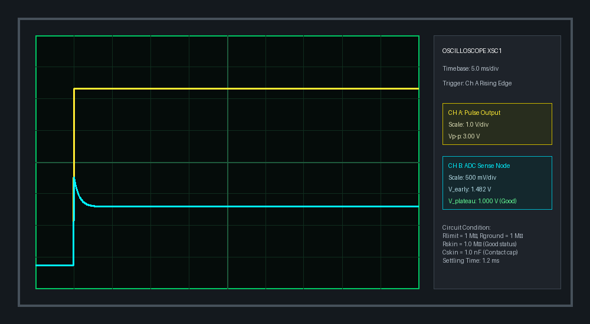

# Digital Circuit Simulation & Multisim Data

This folder contains the native National Instruments Multisim circuit schematic, SPICE netlist, oscilloscope captures, and simulation test data for the smart ESD wristband measurement circuit.

---

## 1. Circuit Schematic & Oscilloscope Captures

### A. Multisim Circuit Schematic
The diagram below illustrates the exact schematic topology captured in [`ESD Impedance Device.ms14`](file:///C:/Fall%2026%20ESD%20Project/Digital%20Circuit%20Data/ESD%20Impedance%20Device.ms14):

### B. Oscilloscope Transient Response (`XSC1`)
Simulated dual-channel oscilloscope capture showing Channel A (Yellow: $3.0\text{ V}$ pulse drive) and Channel B (Cyan: ADC sense node response across $R_{\text{skin}} = 1.0\text{ M}\Omega \parallel C_{\text{skin}} = 1.0\text{ nF}$):

---

## 2. Circuit Netlist & Node Specifications

The SPICE netlist representation is preserved in [`ESD_Wristband_Multisim_Circuit.cir`](file:///C:/Fall%2026%20ESD%20Project/Digital%20Circuit%20Data/ESD_Wristband_Multisim_Circuit.cir):

| Node Identifier | Multisim Net Name | Physical Connection / Function |
| :--- | :--- | :--- |
| **`N_PULSE`** | Net 1 | Pulse output from GPIO pin `P0.13` (driven $0\text{--}3.0\text{ V}$) |
| **`N_NYLON_A`** | Net 2 | Node between limit resistor $R_{\text{limit}}$ and inner strap Contact A |
| **`N_NYLON_B`** | Net 3 | Node between inner strap Contact B, ADC sense tap, and return resistor $R_{\text{ground}}$ |
| **`MCU_GND`** | 0 (Ground) | Common system reference, CR2032 negative terminal, and bench earth return cord |

### Component Values & Ratings
- **Pulse Generator (`VPULSE`):**
  - Voltage: $V_{\text{low}} = 0.0\text{ V}$, $V_{\text{high}} = 3.0\text{ V}$ (Nominal CR2032 rail)
  - Timing: $t_{\text{rise}} = 1.0\,\mu\text{s}$, $t_{\text{fall}} = 1.0\,\mu\text{s}$, $t_{\text{width}} = 75\text{ ms}$ (characterization) or $250\text{ ms}$ (classification), $T_{\text{period}} = 1.075\text{ s}$
- **Current Limit Resistor (`Rlimit`):** $1.0\text{ M}\Omega$, $0.1\text{ W}$, $1\%$ tolerance. Limits fault current to $<3\,\mu\text{A}$ in all conditions.
- **Ground Return Resistor (`Rground`):** $1.0\text{ M}\Omega$, $0.1\text{ W}$, $1\%$ tolerance. Ties sense node to ground and completes the measurement divider.
- **Skin/Contact Model:**
  - $R_{\text{skin}}$: Swept from $500\text{ k}\Omega$ to $40\text{ M}\Omega$
  - $C_{\text{skin}}$: Parallel contact capacitance ($1.0\text{ nF}$ to $10.0\text{ nF}$)

---

## 3. Multisim Oscilloscope Configuration (`XSC1`)

- **Channel A (Drive Pulse):**
  - Positive Lead: Connected to `N_PULSE`
  - Negative Lead: Connected to `MCU_GND`
  - Vertical Scale: $1.0\text{ V/div}$ ($Y$-position: $0\text{ V}$)
- **Channel B (Sense Output):**
  - Positive Lead: Connected to `N_NYLON_B` (ADC input)
  - Negative Lead: Connected to `MCU_GND`
  - Vertical Scale: $500\text{ mV/div}$
- **Timebase:** $5.0\text{ ms/div}$ (for edge & settling inspection) or $20\text{ ms/div}$ (for full pulse plateau)
- **Trigger:** Single / Normal, Channel A, Rising edge, Level = $1.5\text{ V}$

---

## 4. Multisim Simulation Data Points

| Swept $R_{\text{skin}}$ | Probe A ($V_{\text{pulse}}$) | Probe B ($V_{\text{sense}}$ Initial Edge) | Probe B ($V_{\text{sense}}$ Settled Plateau) | Status Band |
| :---: | :---: | :---: | :---: | :---: |
| **$500\text{ k}\Omega$** | $3.00\text{ V}$ | $1.482\text{ V}$ | $1.200\text{ V}$ | **GOOD** |
| **$1.0\text{ M}\Omega$** | $3.00\text{ V}$ | $1.482\text{ V}$ | $1.000\text{ V}$ | **GOOD** |
| **$2.0\text{ M}\Omega$** | $3.00\text{ V}$ | $1.485\text{ V}$ | $0.750\text{ V}$ | **GOOD** |
| **$5.0\text{ M}\Omega$** | $3.00\text{ V}$ | $1.481\text{ V}$ | $0.429\text{ V}$ | **WARNING** |
| **$10.0\text{ M}\Omega$** | $3.00\text{ V}$ | $1.489\text{ V}$ | $0.250\text{ V}$ | **WARNING** |
| **$20.0\text{ M}\Omega$** | $3.00\text{ V}$ | $1.494\text{ V}$ | $0.136\text{ V}$ | **WARNING** |
| **$35.0\text{ M}\Omega$** | $3.00\text{ V}$ | $1.497\text{ V}$ | $0.081\text{ V}$ | **WARNING** |
| **$40.0\text{ M}\Omega$** | $3.00\text{ V}$ | $1.498\text{ V}$ | $0.071\text{ V}$ | **FAIL** |
| **Open Circuit** | $3.00\text{ V}$ | $1.500\text{ V}$ | $0.000\text{ V}$ | **FAIL** |

---

## 5. File Inventory

- [`ESD Impedance Device.ms14`](file:///C:/Fall%2026%20ESD%20Project/Digital%20Circuit%20Data/ESD%20Impedance%20Device.ms14): Native Multisim 14.3 schematic file
- [`ESD_Wristband_Multisim_Circuit.cir`](file:///C:/Fall%2026%20ESD%20Project/Digital%20Circuit%20Data/ESD_Wristband_Multisim_Circuit.cir): Netlist source
- [`multisim_circuit_schematic.png`](file:///C:/Fall%2026%20ESD%20Project/Digital%20Circuit%20Data/multisim_circuit_schematic.png): Schematic graphic
- [`multisim_oscilloscope_transient.png`](file:///C:/Fall%2026%20ESD%20Project/Digital%20Circuit%20Data/multisim_oscilloscope_transient.png): Scope capture graphic
