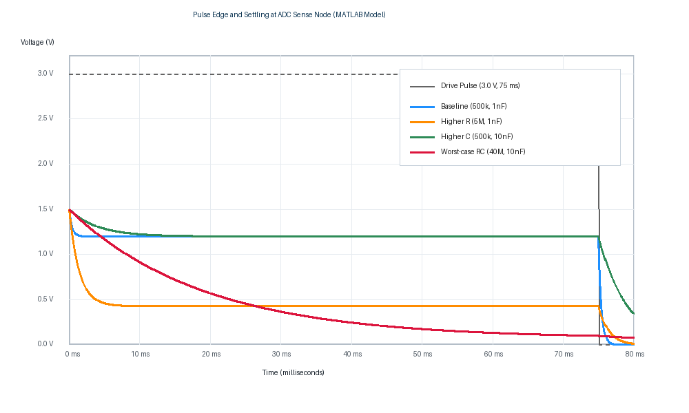
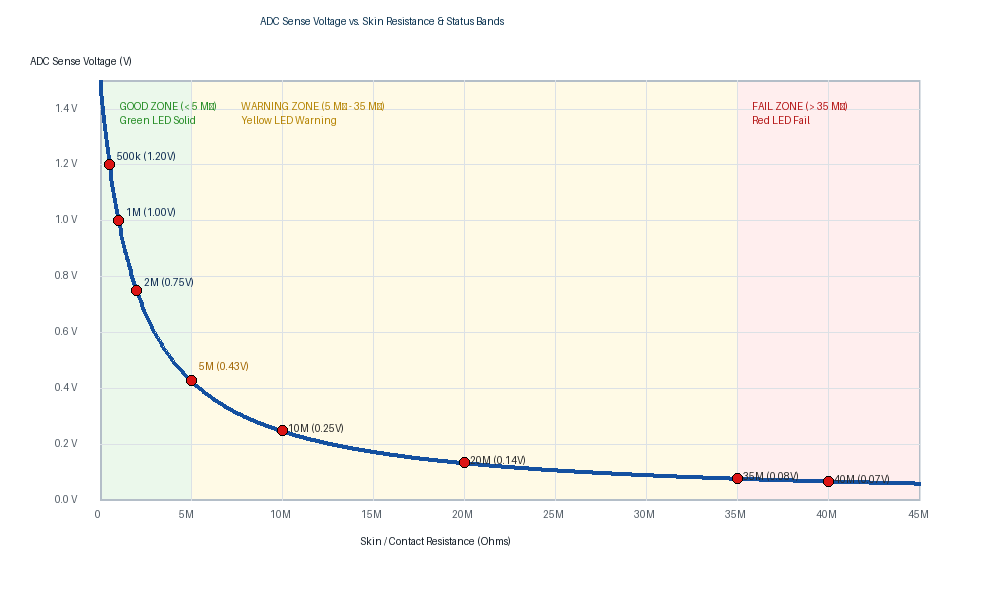

# MATLAB Model & Simulation Analysis

This directory contains the numerical models, analytical calculations, and transient response simulations for the smart ESD wristband monitor based on the **3.0 V nominal CR2032** supply and bare **Nordic nRF52840 SoC** architecture.

---

## 1. Simulation Waveform & Transfer Curve Plots

### A. Pulse Edge and Settling at ADC Sense Node
The plot below illustrates the transient response at the sense node (`Nylon B`) across four illustrative skin resistance and contact capacitance scenarios during a $75\text{ ms}$ pulse:

### B. ADC Sense Voltage vs. Skin Resistance & Status Bands
The transfer curve below maps the relationship between effective user skin/contact resistance and the measured ADC sense voltage, highlighting the **Good** ($<5\text{ M}\Omega$), **Warning** ($5\text{--}35\text{ M}\Omega$), and **Fail** ($>35\text{ M}\Omega$) threshold bands:

---

## 2. Theoretical Circuit Equations

The measurement circuit forms a voltage divider between the driven pulse, current limiting resistor, skin impedance, and return resistor:

$$\text{Pulse Drive (3.0 V)} \longrightarrow R_{\text{limit}} (1\text{ M}\Omega) \longrightarrow \text{Contact A} \longrightarrow [R_{\text{skin}} \parallel C_{\text{skin}}] \longrightarrow \text{Contact B / ADC} \longrightarrow R_{\text{ground}} (1\text{ M}\Omega) \longrightarrow \text{GND}$$

### A. Settled DC Plateau Voltage
At steady-state (plateau), the parallel capacitor $C_{\text{skin}}$ acts as an open circuit:

$$V_{\text{plateau}} = V_{\text{drive}} \cdot \frac{R_{\text{ground}}}{R_{\text{limit}} + R_{\text{skin}} + R_{\text{ground}}} = 3.0\text{ V} \cdot \frac{1\text{ M}\Omega}{2\text{ M}\Omega + R_{\text{skin}}}$$

Solving for skin resistance from measured ADC voltage:

$$R_{\text{skin}} = \frac{3.0\text{ V} \cdot 1\text{ M}\Omega}{V_{\text{ADC}}} - 2\text{ M}\Omega$$

### B. RC Transient Step Response
At the initial step edge ($t = 0^+$), $C_{\text{skin}}$ acts as a short circuit:

$$V_{\text{initial}} = 3.0\text{ V} \cdot \frac{R_{\text{ground}}}{R_{\text{limit}} + R_{\text{ground}}} = 3.0\text{ V} \cdot \frac{1\text{ M}\Omega}{2\text{ M}\Omega} = 1.500\text{ V}$$

The effective Thevenin resistance discharging $C_{\text{skin}}$ is:

$$R_{\text{th}} = R_{\text{skin}} \parallel (R_{\text{limit}} + R_{\text{ground}}) = \frac{2\text{ M}\Omega \cdot R_{\text{skin}}}{2\text{ M}\Omega + R_{\text{skin}}}$$

$$\tau = R_{\text{th}} \cdot C_{\text{skin}}$$

$$V_{\text{ADC}}(t) = V_{\text{plateau}} + (V_{\text{initial}} - V_{\text{plateau}}) \cdot e^{-t / \tau}$$

---

## 3. Full Data Test Points & Calculation Tables

### Table 1: Status Classification vs. Plateau Voltage (From `ESD_Wristband_Status_Calculations.csv`)

| Skin Resistance ($R_{\text{skin}}$) | Sense Voltage ($V_{\text{plateau}}$) | 12-bit ADC Count ($3.6\text{ V}$ Full Scale) | Firmware Status | Active Indicator |
| :--- | :--- | :--- | :--- | :--- |
| **$500\text{ k}\Omega$** | $1.2000\text{ V}$ | $1365$ | **GOOD** | Green LED |
| **$1.0\text{ M}\Omega$** | $1.0000\text{ V}$ | $1138$ | **GOOD** | Green LED |
| **$2.0\text{ M}\Omega$** | $0.7500\text{ V}$ | $853$ | **GOOD** | Green LED |
| **$5.0\text{ M}\Omega$** *(Threshold)* | $0.4286\text{ V}$ | $488$ | **WARNING** | Yellow LED |
| **$10.0\text{ M}\Omega$** | $0.2500\text{ V}$ | $284$ | **WARNING** | Yellow LED |
| **$20.0\text{ M}\Omega$** | $0.1364\text{ V}$ | $155$ | **WARNING** | Yellow LED |
| **$35.0\text{ M}\Omega$** *(Threshold)* | $0.0811\text{ V}$ | $92$ | **WARNING** | Yellow LED |
| **$40.0\text{ M}\Omega$** | $0.0714\text{ V}$ | $81$ | **FAIL** | Red LED |
| **Open Circuit ($\infty$)** | $0.0000\text{ V}$ | $0$ | **FAIL** | Red LED |

*Note: ADC count assumes nominal $0.6\text{ V}$ internal reference with $1/6$ gain ($3.6\text{ V}$ full scale).*

---

### Table 2: Waveform Dynamics Across 4 Scenarios (From `ESD_Wristband_Waveform_Calculations.csv`)

| Scenario | $R_{\text{skin}}$ | $C_{\text{skin}}$ | $\tau$ (Time Const) | $V_{\text{early}}$ ($25\,\mu\text{s}$) | $V_{\text{plateau}}$ | Edge Drop ($\Delta V$) | 5% Transient Decay | 5% Final-Value Settle |
| :--- | :--- | :--- | :--- | :--- | :--- | :--- | :--- | :--- |
| **1. Baseline** | $500\text{ k}\Omega$ | $1.0\text{ nF}$ | $0.400\text{ ms}$ | $1.482\text{ V}$ | $1.200\text{ V}$ | $0.282\text{ V}$ | $1.20\text{ ms}$ | $0.64\text{ ms}$ |
| **2. Higher R** | $5.0\text{ M}\Omega$ | $1.0\text{ nF}$ | $1.429\text{ ms}$ | $1.481\text{ V}$ | $0.429\text{ V}$ | $1.053\text{ V}$ | $4.28\text{ ms}$ | $5.59\text{ ms}$ |
| **3. Higher C** | $500\text{ k}\Omega$ | $10.0\text{ nF}$ | $4.000\text{ ms}$ | $1.498\text{ V}$ | $1.200\text{ V}$ | $0.298\text{ V}$ | $11.98\text{ ms}$ | $6.44\text{ ms}$ |
| **4. Worst-case RC**| $40.0\text{ M}\Omega$ | $10.0\text{ nF}$ | $19.048\text{ ms}$| $1.498\text{ V}$ | $0.071\text{ V}$ | $1.427\text{ V}$ | $57.06\text{ ms}$ | **$114.12\text{ ms}$** |

---

### Table 3: Late-Window Sampling Bias Check (From `ESD_Wristband_Window_Bias_Check.csv`)

This analysis evaluates the effect of pulse window duration on sampling accuracy under worst-case impedance ($40\text{ M}\Omega \parallel 10\text{ nF}$):

| Profile | Sample Window | First Trigger | Last Capture | Average $V_{\text{sense}}$ | Inferred $R$ | Status | Evaluation |
| :--- | :--- | :--- | :--- | :--- | :--- | :--- | :--- |
| **Characterization** | $75\text{ ms}$ | $62.5\text{ ms}$ | $74.79\text{ ms}$ | $0.1137\text{ V}$ | $24.38\text{ M}\Omega$ | **WARNING** | **Biased:** Samples before $114\text{ ms}$ settling point |
| **Classification** | $250\text{ ms}$ | $237.5\text{ ms}$ | $249.79\text{ ms}$ | $0.0714\text{ V}$ | $39.98\text{ M}\Omega$ | **FAIL** | **Accurate:** Correctly identifies ungrounded fail state |

> [!IMPORTANT]
> The $250\text{ ms}$ pulse width is mandatory for Stage 1 firmware classification to ensure the signal settles within $5\%$ of the true plateau before SAADC averaging occurs.

---

## 4. Source Files & Generated Deliverables

- [`esd_wristband_status_model.m`](file:///C:/Fall%2026%20ESD%20Project/MATLAB%20Model/esd_wristband_status_model.m): Complete MATLAB executable script
- [`ESD_Wristband_Calculation_Report.pdf`](file:///C:/Fall%2026%20ESD%20Project/MATLAB%20Model/ESD_Wristband_Calculation_Report.pdf): Formal compiled report
- [`ESD_Wristband_Calculation_Report.html`](file:///C:/Fall%2026%20ESD%20Project/MATLAB%20Model/ESD_Wristband_Calculation_Report.html): Interactive HTML calculation sheet
- [`ESD_Wristband_Status_Calculations.csv`](file:///C:/Fall%2026%20ESD%20Project/MATLAB%20Model/ESD_Wristband_Status_Calculations.csv): Exported numerical data
- [`ESD_Wristband_Waveform_Calculations.csv`](file:///C:/Fall%2026%20ESD%20Project/MATLAB%20Model/ESD_Wristband_Waveform_Calculations.csv): Scenario data
- [`ESD_Wristband_Window_Bias_Check.csv`](file:///C:/Fall%2026%20ESD%20Project/MATLAB%20Model/ESD_Wristband_Window_Bias_Check.csv): Bias verification data
