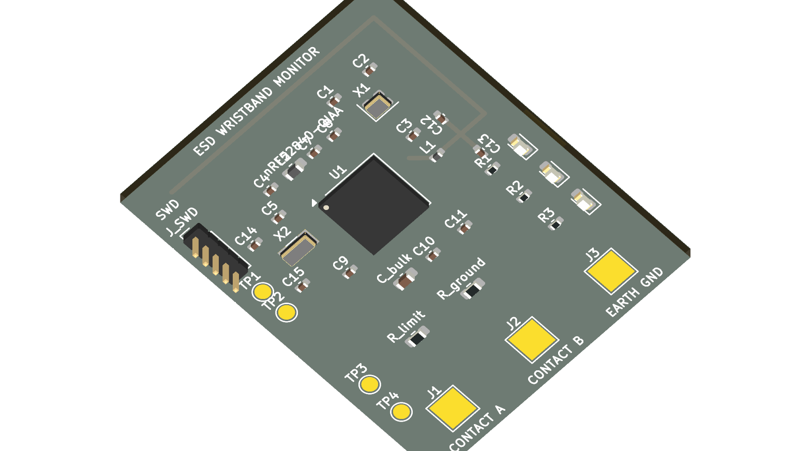
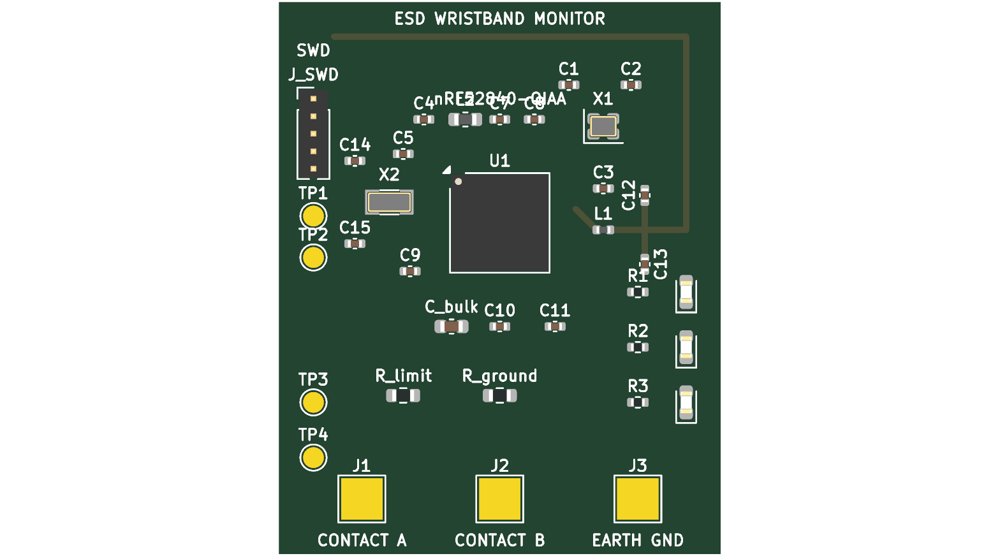

# PCB Design (KiCad 10)

This directory contains the editable KiCad 10 project, manufacturing files, and 3D mechanical handoff models for the bare **Nordic nRF52840-QIAA (aQFN-73)** wearable ESD wristband monitor.

---

## 1. Visual Board Renders

### A. 3D Perspective Isometric Render
Raytraced 3D view showing the physical component placement, bare SoC, crystals, status LEDs, programming header, and inverted-F PCB antenna:

### B. 2D Top Copper & Silkscreen Render
Top-down orthographic view of the $32.0 \times 40.0\text{ mm}$ 2-layer board layout:

---

## 2. Stage 1 Deliverables Summary

| File | Type | Description |
| :--- | :--- | :--- |
| [`ESD_Wristband_Monitor.kicad_pro`](file:///C:/Fall%2026%20ESD%20Project/PCB%20Design/ESD_Wristband_Monitor.kicad_pro) | KiCad Project | Master KiCad 10 project control file |
| [`ESD_Wristband_Monitor.kicad_sch`](file:///C:/Fall%2026%20ESD%20Project/PCB%20Design/ESD_Wristband_Monitor.kicad_sch) | KiCad Schematic | Schematic architecture with bare nRF52840-QIAA |
| [`ESD_Wristband_Monitor.kicad_pcb`](file:///C:/Fall%2026%20ESD%20Project/PCB%20Design/ESD_Wristband_Monitor.kicad_pcb) | KiCad Board | $32 \times 40\text{ mm}$ 2-layer layout with official Nordic footprints & nets |
| [`ESD_Wristband_Monitor.step`](file:///C:/Fall%2026%20ESD%20Project/PCB%20Design/ESD_Wristband_Monitor.step) | 3D STEP Model | AP214 STEP mechanical CAD model for SolidWorks enclosure integration |
| [`erc_report.rpt`](file:///C:/Fall%2026%20ESD%20Project/PCB%20Design/erc_report.rpt) | ERC Log | Electrical Rules Check report (**0 Errors, 0 Warnings**) |
| [`drc_report.rpt`](file:///C:/Fall%2026%20ESD%20Project/PCB%20Design/drc_report.rpt) | DRC Log | Design Rules Check report (**0 Shorts, 0 Clearance Errors**) |
| [`generate_kicad_project.py`](file:///C:/Fall%2026%20ESD%20Project/PCB%20Design/generate_kicad_project.py) | Python Script | Standalone automated generator using official KiCad 10 `pcbnew` Python API |

---

## 3. Nordic Reference Circuit & Hardware Implementation

The design adheres strictly to **Nordic Semiconductor nRF52840 Product Specification v1.11 / v1.12, Section 7.3 (Circuit Configuration No. 2 for QIAA aQFN-73)**:

1. **Power Configuration (Normal Voltage Mode):**
   - Supply: Single CR2032 primary coin cell ($3.0\text{ V}$ nominal, $1.7\text{--}3.6\text{ V}$ operational).
   - High-voltage regulator REG0 bypassed by shorting `VDDH` (Pin Y2) directly to `VDD` (Pins B1, W1, A22, AD14, AD23).
   - `VBUS` (Pin AD2) tied directly to ground (USB powered down, no charger circuit).
2. **Internal REG1 DC/DC Converter:**
   - DC/DC switching inductor $L_2$ ($10\,\mu\text{H}$, 0603) placed between `DCC` (Pin B3) and `DEC4_6` to reduce active current from the coin cell by up to $50\%$.
3. **Mandatory Silicon Bridge (`DEC4_6`):**
   - `DEC4` (Pin B5) and `DEC6` (Pin E24) must be shorted together externally on the PCB with a $1.0\,\mu\text{F}$ decoupling capacitor ($C_4$) to ground to supply the 2.4 GHz radio synthesizer.
4. **RF Matching Network & Antenna:**
   - Single-ended $50\,\Omega$ Pi-network on pin `ANT` (H23):
     - Series inductor: $L_1 = 3.9\text{ nH}$ (0402)
     - Shunt capacitors: $C_{12} = 1.2\text{ pF}$ (0402) and $C_{13} = 1.5\text{ pF}$ (0402)
     - Inverted-F quarter-wave PCB trace antenna routed along the top board edge with ground plane clearance.
5. **Crystals:**
   - High Frequency: $32.0\text{ MHz}$ crystal ($X_1$) with two $12\text{ pF}$ load capacitors ($C_1, C_2$) on pins `XC1`/`XC2`.
   - Low Frequency: $32.768\text{ kHz}$ tuning fork crystal ($X_2$) with two $12\text{ pF}$ load capacitors ($C_{14}, C_{15}$) on pins `XL1`/`XL2`.

---

## 4. ERC & DRC Full Verification Summary

### Electrical Rules Check (`erc_report.rpt`):
- **Errors:** 0
- **Warnings:** 0
- **Status:** **PASS**

### Design Rules Check (`drc_report.rpt`):
- **Short Circuits:** 0
- **Clearance Violations:** 0
- **Courtyard Overlaps:** 0
- **Unconnected Pads:** 71 (unrouted ratline nets ready for interactive routing)
- **Dangling Tracks:** 2 (Antenna open monopole tip + RF entry tap)
- **Silkscreen Clearances:** 5 minor label margin warnings

---

## 5. Engineering Analysis & Review Documents

- [Stage 1 KiCad Proposal and Open Decisions](Stage%201%20KiCad%20Proposal%20and%20Open%20Decisions.md): Detailed circuit proposal, complete BOM, and 4 flagged hardware review items.
- [SAADC Interface Review](SAADC%20Interface%20Review.md): Analysis of source impedance ($1\text{ M}\Omega$) vs. Nordic $800\text{ k}\Omega$ guideline.
