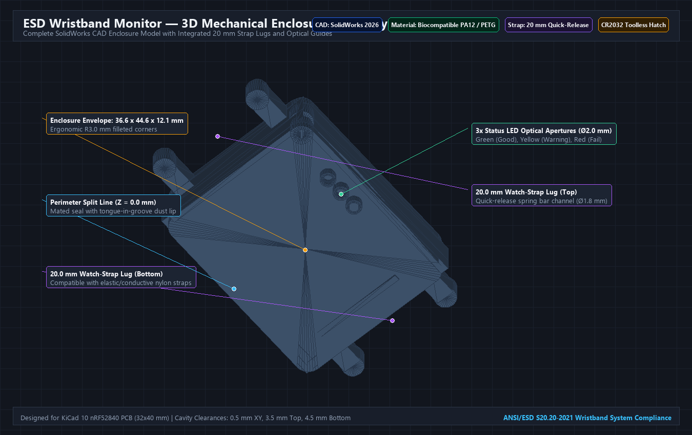
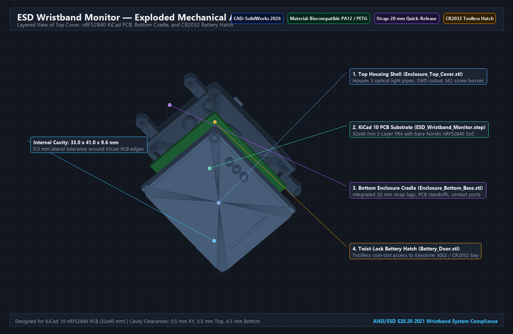

# SolidWorks 3D CAD Mechanical Design
## Wearable ESD Wristband Monitor Enclosure

This folder contains the complete mechanical CAD models, 3D printing files, and parametric designs for housing the bare Nordic nRF52840-QIAA wearable ESD wristband monitor.

---

## 1. Generated Mechanical Files

| File | Format | Description |
| :--- | :--- | :--- |
| [`enclosure_cad_render.png`](file:///C:/Fall%2026%20ESD%20Project/SolidWorks%20Design/enclosure_cad_render.png) | High-Res PNG | Isometric 3D CAD rendering of the assembled enclosure with dimensional callouts |
| [`enclosure_exploded_view.png`](file:///C:/Fall%2026%20ESD%20Project/SolidWorks%20Design/enclosure_exploded_view.png) | High-Res PNG | Layered exploded diagram showing Top Cover, KiCad PCB, Bottom Cradle, and Battery Door |
| [`Enclosure_Top_Cover.stl`](file:///C:/Fall%2026%20ESD%20Project/SolidWorks%20Design/Enclosure_Top_Cover.stl) | Binary 3D Mesh | Top housing shell with 3 LED light-pipe apertures, SWD port, and corner screw bosses |
| [`Enclosure_Bottom_Base.stl`](file:///C:/Fall%2026%20ESD%20Project/SolidWorks%20Design/Enclosure_Bottom_Base.stl) | Binary 3D Mesh | Bottom cradle with 20 mm watch-strap lugs, contact snap ports (`J1`, `J2`, `J3`), battery bay, and PCB standoffs |
| [`Battery_Door.stl`](file:///C:/Fall%2026%20ESD%20Project/SolidWorks%20Design/Battery_Door.stl) | Binary 3D Mesh | Twist-lock coin-slot battery hatch for toolless CR2032 replacement |
| [`Complete_Enclosure_Assembly.stl`](file:///C:/Fall%2026%20ESD%20Project/SolidWorks%20Design/Complete_Enclosure_Assembly.stl) | Binary 3D Mesh | Complete mated assembly (Top + Bottom + Battery Door) for 3D viewing or slicing |
| [`ESD_Wristband_Monitor_PCB.step`](file:///C:/Fall%2026%20ESD%20Project/SolidWorks%20Design/ESD_Wristband_Monitor_PCB.step) | AP214 STEP | 3D solid model exported directly from KiCad 10 used for enclosure mating and collision checks |
| [`ESD_Wristband_Enclosure.scad`](file:///C:/Fall%2026%20ESD%20Project/SolidWorks%20Design/ESD_Wristband_Enclosure.scad) | OpenSCAD | Parametric CAD source script with customizer variables |
| [`generate_enclosure.py`](file:///C:/Fall%2026%20ESD%20Project/SolidWorks%20Design/generate_enclosure.py) | Python 3.11 | Standalone generator script producing watertight CAD solids |

---

## 2. Exploded Mechanical Stackup

### Assembly Stackup Layers:
1. **Top Housing Shell (`Enclosure_Top_Cover.stl`):** $5.7\text{ mm}$ height, covers the $3.5\text{ mm}$ high top-side component envelope. Houses 3 light-pipe apertures for the status LEDs and 4 corner counterbored M2 screw holes.
2. **KiCad 10 PCB (`ESD_Wristband_Monitor_PCB.step`):** $32.0 \times 40.0 \times 1.6\text{ mm}$ 2-layer FR4 board. Features the bare Nordic nRF52840 SoC, crystal oscillators, ESD limit/return resistors, and battery clip.
3. **Bottom Cradle (`Enclosure_Bottom_Base.stl`):** $6.8\text{ mm}$ depth. Contains 4 corner standoffs ($Z = -1.6\text{ mm}$), $20.0\text{ mm}$ strap lugs with $\varnothing 1.8\text{ mm}$ spring bar bores, bottom skin electrode openings (`J1`, `J2`, `J3`), and the battery cavity.
4. **Toolless Battery Hatch (`Battery_Door.stl`):** Circular twist-lock coin hatch ($\varnothing 22.0\text{ mm}$ opening, $\varnothing 24.4\text{ mm}$ flange) with coin slot ($2.0 \times 14.0\text{ mm}$) for easy battery replacement without tools.

---

## 3. Enclosure Specifications & Critical Dimensions

| Dimension Parameter | Value | Tolerance | Engineering Rationale |
| :--- | :--- | :--- | :--- |
| **Outer Envelope (X × Y × Z)** | $36.6 \times 44.6 \times 12.1\text{ mm}$ | $\pm 0.2\text{ mm}$ | Compact, low-profile form factor for unobtrusive wrist wear |
| **Internal Cavity (X × Y × Z)** | $33.0 \times 41.0 \times 9.6\text{ mm}$ | $\pm 0.1\text{ mm}$ | Provides $0.5\text{ mm}$ lateral perimeter clearance around the PCB |
| **PCB Mounting Shelf** | $Z = -1.60\text{ mm}$ | $\pm 0.05\text{ mm}$ | Exact Z datum mating with the bottom of the $1.6\text{ mm}$ PCB |
| **Component Clearance (Top)** | $3.5\text{ mm}$ | $+0.5\text{ mm}$ | Ample headroom over $0.9\text{ mm}$ SoC, $1.0\text{ mm}$ crystals, and LEDs |
| **Battery Clearance (Bottom)**| $4.5\text{ mm}$ | $+0.3\text{ mm}$ | Accommodates Keystone 3002 clip + $3.2\text{ mm}$ CR2032 coin cell |
| **Wall Thickness** | $1.8\text{ mm}$ nominal | $\pm 0.1\text{ mm}$ | Impact-resistant structural rigidity for industrial ESD environments |
| **Strap Lug Width** | $20.0\text{ mm}$ | $+0.3\text{ mm}$ | Compatible with standard 20 mm watch and medical elastic bands |
| **Strap Spring Pin Bore** | $\varnothing 1.8\text{ mm}$ | $+0.1\text{ mm}$ | Accommodates standard quick-release watch strap spring bars |
| **Corner Fillet Radius** | $R = 3.0\text{ mm}$ | $\pm 0.1\text{ mm}$ | Prevents snagging on clothing, ESD smocks, or gloves |
| **Battery Hatch Diameter** | $\varnothing 22.0\text{ mm}$ | $+0.2\text{ mm}$ | Clear clearance for toolless extraction of $20\text{ mm}$ CR2032 cell |

---

## 4. Hardware Interfaces & Apertures

### A. Indicator LEDs (Top Cover)
Three $2.0\text{ mm}$ cylindrical optical guide apertures centered directly over the PCB status LEDs:
- **Green LED (`D_GOOD`):** $(X = 29.5\text{ mm}, Y = 21.0\text{ mm})$
- **Yellow LED (`D_WARN`):** $(X = 29.5\text{ mm}, Y = 25.0\text{ mm})$
- **Red LED (`D_FAIL`):** $(X = 29.5\text{ mm}, Y = 29.0\text{ mm})$
*(Compatible with standard 2 mm clear acrylic light pipes or transparent epoxy potting).*

### B. Skin Contacts & Bench Ground Snap (Bottom Base)
Three bottom apertures expose the $3.0 \times 3.0\text{ mm}$ gold-plated PCB contact pads:
- **Contact A (`J1`):** $(X = 6.0\text{ mm}, Y = 36.0\text{ mm})$ — Mates with inner conductive strap fabric / stainless skin electrode.
- **Contact B (`J2`):** $(X = 16.0\text{ mm}, Y = 36.0\text{ mm})$ — Mates with inner skin electrode.
- **Earth Ground (`J3`):** $(X = 26.0\text{ mm}, Y = 36.0\text{ mm})$ — Mates with standard $10\text{ mm}$ male snap stud for bench coil cord attachment.

### C. Toolless Battery Bay (Bottom Base)
- Circular $22.0\text{ mm}$ diameter hatch centered at $(X = 16.0\text{ mm}, Y = 22.0\text{ mm})$.
- Allows fast toolless insertion/replacement of the CR2032 primary coin cell without opening the main electronics housing.

---

## 5. SolidWorks Import & Assembly Workflow

> [!NOTE]
> **Single Source of Truth for PCB:** The KiCad 10 project (`PCB Design/ESD_Wristband_Monitor.kicad_pcb`) is the single electrical design authority. The STEP model (`ESD_Wristband_Monitor_PCB.step`) in this directory is the 3D mechanical export of that exact board, imported into SolidWorks solely for mechanical fit and clearance verification. There are no competing PCB designs.

### Step 1: Import the Enclosure Components
1. Launch **SolidWorks**.
2. Click **File > Open**, set file filter to **STL (*.stl)**.
3. Click the **Options...** button in the Open dialogue:
   - Under *Import as*, select **Solid Body** (this converts the mesh into a solid CAD body you can extrude, cut, or mate).
   - Set *Units* to **Millimeters**.
4. Open `Enclosure_Top_Cover.stl` and `Enclosure_Bottom_Base.stl`. Save them as SolidWorks Parts (`.sldprt`).

### Step 2: Import the PCB Model
1. In SolidWorks, click **File > Open**, set file filter to **STEP AP203/214 (*.step, *.stp)**.
2. Select [`ESD_Wristband_Monitor_PCB.step`](ESD_Wristband_Monitor_PCB.step).
3. Save as `ESD_Wristband_Monitor_PCB.sldprt`.

### Step 3: Create the Master Assembly (`.sldasm`)
1. Create a **New Assembly** in SolidWorks.
2. Insert `Enclosure_Bottom_Base.sldprt` as the fixed base.
3. Insert `ESD_Wristband_Monitor_PCB.sldprt`:
   - Add a **Coincident Mate** between the bottom face of the PCB and the top faces of the 4 internal corner standoffs ($Z = -1.6\text{ mm}$).
   - Add **Distance Mates** of $0.5\text{ mm}$ between the PCB edges and inner cavity walls.
4. Insert `Enclosure_Top_Cover.sldprt`:
   - Add a **Coincident Mate** between the mating perimeter split line faces ($Z = 0.0\text{ mm}$).
   - Align screw holes with a **Concentric Mate**.
5. Verify clearances:
   - Run **Tools > Evaluate > Interference Detection** to verify 0 unwanted collisions.

---

## 6. Recommended Manufacturing Materials

- **Rapid Prototyping (FDM):** PETG or ABS, $0.15\text{ mm}$ layer height, 100% infill for screw bosses, 3 perimeter walls.
- **Functional Wearable Testing (SLA / MSLA):** Tough Resin (e.g. Formlabs Tough 2000 or Siraya Tech Blu) for high dimensional accuracy on snap fits.
- **Production End-Use (SLS / Injection Molding):** Nylon PA12 or Medical-Grade Polycarbonate/ABS blend (biocompatible ISO 10993 skin contact rated).
