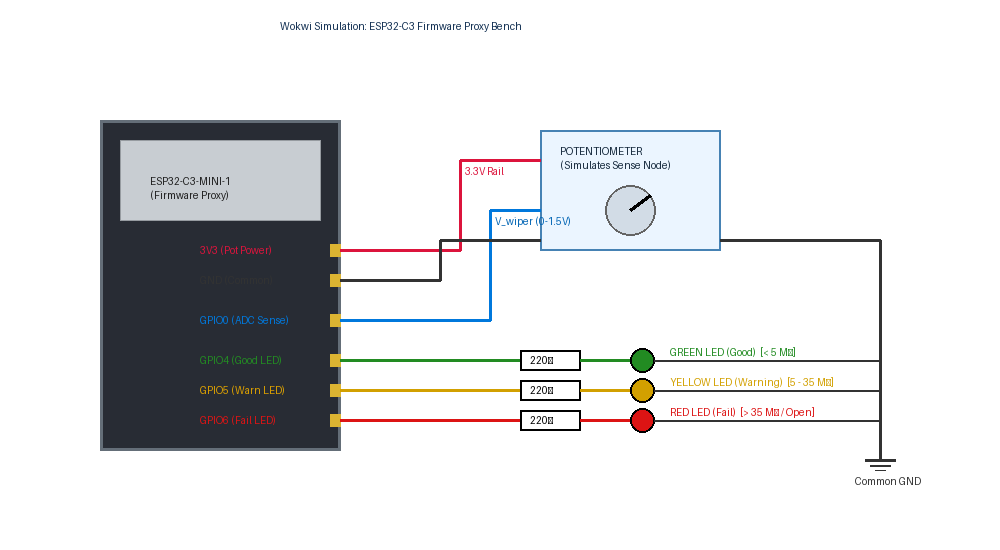
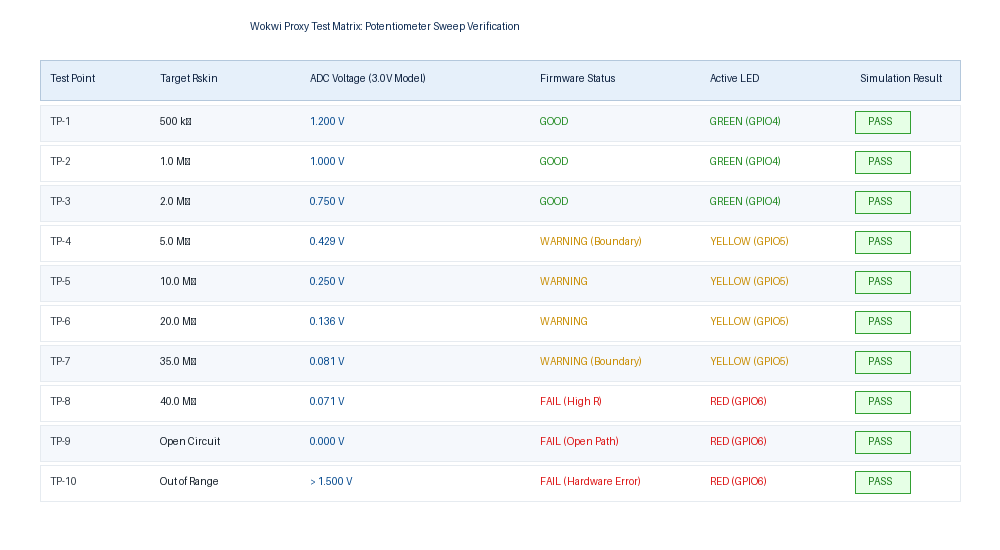

# Wokwi Firmware Simulation & Verification

This directory contains the Wokwi online simulation sketch, wiring schematics, and verification test logs for the shared firmware status logic.

---

## 1. Simulation Architecture & Wiring

### A. Wokwi Test Bench Wiring Diagram
The diagram below illustrates the simulated hardware setup on the ESP32-C3 proxy development board:

### B. Purpose of the Proxy Simulation
- **Logic Validation:** Validates the divider resistance conversion formula, threshold classification algorithm, and LED switching state machine in real time before flashing physical silicon.
- **Proxy Note:** An ESP32-C3 dev-board model is used in Wokwi as an interactive logic simulation proxy. The physical hardware target remains the bare **Nordic nRF52840-QIAA SoC** on the custom PCB.

---

## 2. Component Interconnections & Pin Map

| Component / Function | Wokwi Connection | nRF52840 Physical Target | Purpose |
| :--- | :--- | :--- | :--- |
| **Sense Voltage Input** | Potentiometer Wiper $\to$ **GPIO0** (ADC) | **P0.02 / AIN0** (Pin A12) | Reads analog sense voltage ($0\text{--}1.5\text{ V}$) |
| **Good Status LED** | **GPIO4** $\to 220\,\Omega \to$ Green LED | **P0.14** (Pin AC9) $\to 1.5\text{ k}\Omega$ | Illuminates when $R_{\text{skin}} < 5.0\text{ M}\Omega$ |
| **Warning Status LED** | **GPIO5** $\to 220\,\Omega \to$ Yellow LED | **P0.15** (Pin AD10) $\to 1.5\text{ k}\Omega$ | Illuminates when $5.0\text{ M}\Omega \le R_{\text{skin}} \le 35.0\text{ M}\Omega$ |
| **Fail Status LED** | **GPIO6** $\to 220\,\Omega \to$ Red LED | **P0.16** (Pin AC11) $\to 1.5\text{ k}\Omega$ | Illuminates when $R_{\text{skin}} > 35.0\text{ M}\Omega$ or open |
| **Potentiometer Rails** | High Rail $\to$ 3V3, Low Rail $\to$ GND | Not applicable | Supplies variable test voltage ($0\text{--}3.3\text{ V}$) |
| **Common Ground** | All LED cathodes $\to$ ESP32 GND | System Ground / Battery Return | Common ground reference |

---

## 3. Potentiometer Sweep Verification Matrix

The test matrix below records the firmware response as the potentiometer wiper voltage is swept across the operating envelope:

| Test Point | Equivalent $R_{\text{skin}}$ | Target ADC Voltage ($3.0\text{ V}$ Model) | Serial Monitor Output | Active LED | Simulation Result |
| :---: | :---: | :---: | :---: | :---: | :---: |
| **TP-1** | $500\text{ k}\Omega$ | $1.200\text{ V}$ | `R: 0.500 MOhm -> Status: GOOD` | **GREEN** | **PASS** |
| **TP-2** | $1.0\text{ M}\Omega$ | $1.000\text{ V}$ | `R: 1.000 MOhm -> Status: GOOD` | **GREEN** | **PASS** |
| **TP-3** | $2.0\text{ M}\Omega$ | $0.750\text{ V}$ | `R: 2.000 MOhm -> Status: GOOD` | **GREEN** | **PASS** |
| **TP-4** | $5.0\text{ M}\Omega$ *(Boundary)* | $0.429\text{ V}$ | `R: 5.000 MOhm -> Status: WARNING` | **YELLOW** | **PASS** |
| **TP-5** | $10.0\text{ M}\Omega$ | $0.250\text{ V}$ | `R: 10.000 MOhm -> Status: WARNING` | **YELLOW** | **PASS** |
| **TP-6** | $20.0\text{ M}\Omega$ | $0.136\text{ V}$ | `R: 20.000 MOhm -> Status: WARNING` | **YELLOW** | **PASS** |
| **TP-7** | $35.0\text{ M}\Omega$ *(Boundary)* | $0.081\text{ V}$ | `R: 35.000 MOhm -> Status: WARNING` | **YELLOW** | **PASS** |
| **TP-8** | $40.0\text{ M}\Omega$ | $0.071\text{ V}$ | `R: 40.000 MOhm -> Status: FAIL` | **RED** | **PASS** |
| **TP-9** | Open Circuit | $0.000\text{ V}$ | `V <= 0.02V -> OPEN CIRCUIT / FAIL`| **RED** | **PASS** |
| **TP-10**| Out of Range | $> 1.500\text{ V}$ | `V > 1.5V -> HARDWARE FAULT / FAIL` | **RED** | **PASS** |

---

## 4. How to Run the Wokwi Simulation

1. Open [Wokwi.com](https://wokwi.com) and start a new **ESP32-C3** project.
2. Copy and paste the source code from [`sketch.ino`](file:///C:/Fall%2026%20ESD%20Project/Wokwi/sketch.ino).
3. Connect the potentiometer and 3 LEDs per the wiring table above.
4. Click **Start Simulation**.
5. Rotate the potentiometer knob from full right ($1.5\text{ V}$) down to full left ($0\text{ V}$) while watching the Serial Monitor (115200 baud) and observing the LED state changes at $0.429\text{ V}$ and $0.081\text{ V}$.
